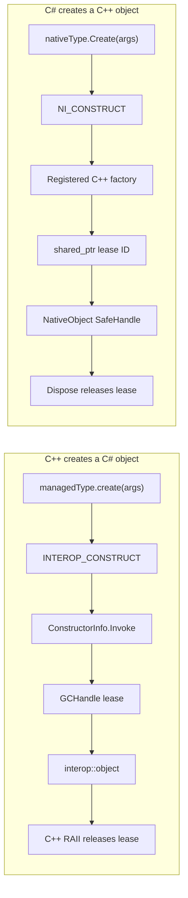

# C++ / .NET interop

Two independent bridges for **C++17 and .NET Framework 4.8 on Windows x64**,
with optional modern .NET 8+ support.

| Direction | Caller | Callee | Documentation |
| --- | --- | --- | --- |
| Unmanaged → managed | C++ application | .NET objects through CLR hosting and reflection | [unmanaged_to_managed](unmanaged_to_managed/README.md) |
| Managed → unmanaged | C# application | Registered C++ objects in a native library | [managed_to_umanaged](managed_to_umanaged/README.md) |

The folder name `managed_to_umanaged/` is retained as requested. Each folder has
its own CMake project, public interface, examples, tests, and architecture and
flow diagrams.

```text
unmanaged_to_managed/
  include/interop/          C++ caller API and C ABI
  src/interop.cpp          CLR startup, ABI calls, C++ wrappers, RAII release
  managed/Interop.Managed/ Managed reflection bridge
  examples/                C++ application
  tests/                   Native integration tests and managed fixture
managed_to_umanaged/
  include/native_interop/   C++ registration API and C ABI
  src/                     Native dispatch, values, and object leases
  managed/Interop.Native/  C# caller API and native library loader
  examples/                Native plugin and C# application
  tests/                   Managed integration tests and native ABI tests
```

## Build both directions

Use Visual Studio 2022 with C++ desktop tools and the Windows SDK, CMake 3.22+,
and .NET SDK 8+ to compile the managed projects. The default output targets
**.NET Framework 4.8**, so deployed applications require the Framework runtime.
The newer SDK is a build tool requirement.

From this repository root, use a fresh build directory after the layout change:

```powershell
cmake -S . -B build-all -A x64
cmake --build build-all --config Release
ctest --test-dir build-all -C Release --output-on-failure
```

To use modern .NET on Linux, macOS, or Windows, select an installed target and
matching runtime explicitly; for example:

```sh
cmake -S . -B build-modern -DINTEROP_TARGET_FRAMEWORK=net8.0 -DCMAKE_BUILD_TYPE=Release
cmake --build build-modern --parallel
ctest --test-dir build-modern --output-on-failure
```

Each direction can also be built independently with `cmake -S unmanaged_to_managed`
or `cmake -S managed_to_umanaged`. At the root, set
`-DINTEROP_BUILD_UNMANAGED_TO_MANAGED=OFF` or
`-DINTEROP_BUILD_MANAGED_TO_UNMANAGED=OFF` to omit one direction. See the individual
READMEs for complete standalone commands and example executable paths.

## Create a managed object from C++

```cpp
interop::runtime runtime("Interop.Managed.dll");
auto managedType = runtime.resolve_type("System.IO.MemoryStream");
auto managedObject = managedType.create({std::int32_t{256}});
managedObject.call("WriteByte", {std::uint8_t{42}});
auto length = managedObject.get("Length").as<std::int64_t>(); // 1
managedObject.dispose(); // Explicitly dispose IDisposable resources.
```

See the [managed-object creation flow](unmanaged_to_managed/README.md#object-creation-flow)
for the constructor call, GCHandle lease handoff, and C++ RAII release.

## Create a native object from C#

```csharp
using Interop.Native;

using var runtime = new NativeRuntime("native_sample.dll");
var nativeType = runtime.LoadType("Demo.Counter");
using var nativeObject = nativeType.Create(10);
int result = nativeObject.Call<int>("Add", 5); // 15
nativeObject.Set("Value", 42);
int current = nativeObject.Get<int>("Value"); // 42
```

See the [native-object creation flow](managed_to_umanaged/README.md#object-creation-flow)
for factory registration, lease adoption, and `SafeHandle` cleanup.

## Object creation flows



Both directions use explicit numeric widths, UTF-8 strings, arrays, opaque object
leases, and exception-to-result conversion at a C ABI boundary. They have separate
ABIs and ownership mechanisms: C++ → C# uses ABI v2, while C# → C++ uses ABI v1.
Object handles cannot be exchanged between them.
C++ types in the reverse direction explicitly register their constructors and
exposed members; C++17 supplies no runtime reflection for arbitrary classes.

## Implementation and migration guides

- [Build an interop bridge from scratch](docs/BUILD_AN_INTEROP_BRIDGE.md): small
  milestones with concrete deliverables and checks for both call directions.
- [Replace C++/CLI incrementally in a Visual Studio solution](docs/MIGRATE_CPPCLI_IN_VISUAL_STUDIO.md):
  project integration, coexistence behind a stable interface, deployment, testing,
  and rollback while migrating one wrapper at a time.
