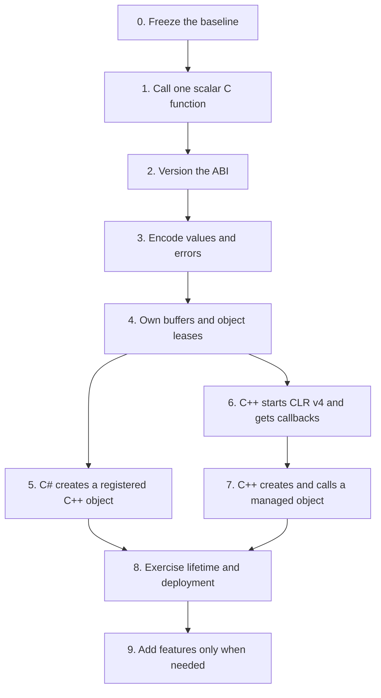

# Build a C++17 / .NET Framework 4.8 interop bridge from scratch

This is a sequence of small implementation milestones for building the two
directions in this repository. Start in a separate learning solution and keep each
milestone runnable before adding the next one. The baseline is **Windows x64,
C++17, and .NET Framework 4.8**, with no `/clr` compilation in the new native code.
Modern .NET hosting is an optional final step.

The bridge runs both languages in one process. Its central contract is a C ABI:
fixed-layout data, explicit calling conventions, status codes, and opaque object
leases. C++ classes, STL containers, and managed object references stay on their
own side. Thin language-specific wrappers make that contract pleasant to use.

For integration into an existing solution, use the companion
[C++/CLI migration guide](MIGRATE_CPPCLI_IN_VISUAL_STUDIO.md). This guide explains how to
build the mechanism itself.

## Milestone map



Each milestone below names a deliverable and a concrete completion check. The
source links show the fuller implementation; reproduce only the current step
instead of copying the entire bridge at once.

## 0. Freeze the baseline and create a tiny solution

**Build:** create a native DLL, a native console executable, a C# `net48` console
executable, and a C# `net48` class library. Use Visual Studio 2022 C++ desktop tools
and the Windows SDK. For the repository's SDK-style C# projects, install .NET SDK
8+; it is a compiler/build dependency, while the deployed target is Framework 4.8.
The projects restore Framework reference assemblies from NuGet and specify C# 12.
Building their source inside Visual Studio therefore needs a C# 12-capable version
(Visual Studio 2022 17.8 or later); an older IDE can instead consume the assemblies
built separately with `dotnet`. Applications referencing those assemblies need not
adopt C# 12. See the [Visual Studio 17.8 language support notes](https://learn.microsoft.com/en-us/visualstudio/releases/2022/release-notes-v17.8).

Set native code to C++17 and all runnable projects to x64. Disable Prefer 32-bit
for managed executables. Build plain C++ without `/clr`. Begin with one synchronous
call and one scalar type; defer callbacks, UI thread dispatch, and asynchronous work.

Write down these decisions before code grows:

| Decision | Initial contract |
| --- | --- |
| Process and architecture | Same process, x64 only |
| Entry points | C linkage, explicit `__cdecl` |
| First value | Signed 32-bit integer |
| Success/failure | Zero status succeeds; nonzero status fails |
| Request buffers | Caller owns them until the call returns |
| Result buffers | Callee allocates; callee's cleanup function frees |
| Objects | Opaque leases, never raw managed object addresses |

**Done when:** both executables run as 64-bit processes and the native DLL builds
without managed extensions. Save this as the first working checkpoint.

**Reference:** [root build configuration](../CMakeLists.txt) and
[managed project settings](../managed_to_umanaged/managed/Interop.Native/Interop.Native.csproj).

## 1. Make one C# → C++ scalar call

**Build:** export a function from `scratch_native.dll`:

```cpp
#include <cstdint>

extern "C" __declspec(dllexport)
std::int32_t __cdecl bridge_echo_i32(std::int32_t value) noexcept {
    return value;
}
```

Call it from a Framework 4.8 console application. This complete caller deliberately
uses syntax that also works with older C# compilers:

```csharp
using System;
using System.Runtime.InteropServices;

internal static class Program
{
    [DllImport("scratch_native.dll", ExactSpelling = true,
        CallingConvention = CallingConvention.Cdecl)]
    private static extern int bridge_echo_i32(int value);

    private static void Main()
    {
        if (!Environment.Is64BitProcess) throw new Exception("Use x64");
        if (bridge_echo_i32(42) != 42) throw new Exception("Echo failed");
        Console.WriteLine("Scalar call passed");
    }
}
```

Place the DLL beside the executable. Set a breakpoint in the export and inspect
the argument. P/Invoke supplies the managed-to-native transition; `DllImport` is
the appropriate form for this Framework target. See Microsoft's
[P/Invoke overview](https://learn.microsoft.com/en-us/dotnet/standard/native-interop/pinvoke).

**Done when:** `42`, `0`, `int.MinValue`, and `int.MaxValue` round-trip unchanged.
Renaming the DLL produces a visible loading failure. Restore it before continuing.
No strings, object ownership, or dispatcher are needed yet.

## 2. Replace individual exports with a versioned API table

**Build:** introduce a small C-compatible header containing a request, a result,
and an API table. Initially support only an `EchoI32` operation. Return the table
from an exported `get_api(version, size, output)` function. Include two function
pointers: `invoke(request, result)` and `free_result(result)`.

Mirror the structs in C# with sequential layout and exact integer widths. Use
`IntPtr` for pointers, including function pointers in the Framework build. Declare
delegates with `[UnmanagedFunctionPointer(CallingConvention.Cdecl)]`. Load the DLL,
find its entry point, and convert the returned pointers to delegates. Keep the DLL
loaded for as long as any returned delegate can be called.

Validate version, sizes, reserved fields, and required function pointers before
invocation. Assert sizes and offsets on both sides; changing packing to silence a
mismatch hides the underlying contract error. The repository's x64 value layout is:

```cpp
struct bridge_value {
    std::int32_t kind;
    std::int32_t reserved;
    std::uint64_t scalar;
    const void* data;
    std::int64_t length;
}; // x64: 32 bytes; data starts at offset 16
```

**Done when:** the scalar test passes through the table. A wrong version or request
size fails before application code runs. Both languages agree on every field
offset. Keep a test for each mismatch as the ABI grows.

**Reference:** [native ABI](../managed_to_umanaged/include/native_interop/abi.h),
[C# layouts](../managed_to_umanaged/managed/Interop.Native/Abi.cs), and
[loader and delegate handling](../managed_to_umanaged/managed/Interop.Native/Module.cs).

## 3. Add values and an error channel in small increments

**Build:** extend the value tag and conversion code one category at a time:

1. Null, bool, and fixed-width integers. Do not rely on C++ `long` matching C# `long`.
2. Floating point. Preserve IEEE bits in the scalar payload instead of performing
   an integer conversion.
3. UTF-8 strings using a pointer and byte count. An empty string differs from null,
   and an embedded NUL is data rather than a terminator.
4. One-dimensional arrays of ABI values, then nested arrays with a depth limit.

For each category, implement both encoding and decoding before moving on. Validate
tags, reserved fields, lengths, pointer/length combinations, and allocation sizes.
These checks detect invalid contracts; raw in-process pointers are still trusted
inputs and do not provide process isolation.

Add error type and message fields. Catch ordinary exceptions inside every callable
ABI entry point, including initial registration. On failure, return a nonzero
status; reconstruct a language-appropriate exception only after control returns
to the caller. Ensure an allocation failure while reporting the first error still
returns a status with a safely freeable partial result. Never unwind a C++ or
managed exception through the other language's stack frames.

**Done when:** Unicode, `"A\0B"`, empty strings, null, empty arrays, and nested arrays
round-trip. A deliberate native failure becomes a C# exception with its message.
Wrong value kinds fail predictably. Buffers created before a failure are freed.

**Reference:** [native value conversion and dispatch](../managed_to_umanaged/src/interop.cpp)
and [managed value conversion](../managed_to_umanaged/managed/Interop.Native/Marshalling.cs).

## 4. Give buffers and objects explicit owners

**Build:** make result cleanup unconditional with C++ RAII or C# `finally`.
`free_result` belongs to the allocating side, recursively frees arrays, and resets
the result. Free failed results as well as successful ones. Never call `delete`,
`free`, or a different allocator on memory returned by the other component.

For C# → C++, introduce a registry from monotonically issued lease IDs to
`std::shared_ptr<object>`. Lookup and release validate the ID; an old ID must
never silently select a new object. For C++ → C#, this branch instead puts a
normal `GCHandle` value in `scalar` for each exported lease. The handle roots a
managed object directly. Separate exports of the same object get separate handles.
The C++ RAII wrapper releases each GCHandle exactly once. GCHandle slots may be
reused, so raw ABI callers must never use an expired or invented handle value.

Decide what happens if a caller fails to decode a result. In this repository a
result owns every exported lease until the caller adopts it: after taking ownership,
the decoder clears that value's scalar before `free_result`. Cleanup releases all
unadopted leases, including those inside arrays. This is a protocol rule, not an
optional optimization.

Wrap native leases in a C# `SafeHandle`. Pin the owner and object arguments during
calls; retain the module until active calls and object wrappers release it. Wrap
managed leases in C++ shared state whose nonthrowing destructor sends a release
request. Copying a wrapper and exporting another lease are distinct operations.

**Done when:** an alias survives release of its sibling; the last owner destroys
the native object exactly once. Abandoning a result releases its leases. Decoding
to the wrong C# result type leaks nothing. Repeated result cleanup is safe, and
stale native registry IDs fail on lookup. Managed GCHandle leases must be released
exactly once by their C++ owner. Compare the live-lease count with the baseline
after each test scope.

**Reference:** [native registry](../managed_to_umanaged/src/interop.cpp),
[SafeHandle and module ownership](../managed_to_umanaged/managed/Interop.Native/Module.cs),
and [managed GCHandle operations](../unmanaged_to_managed/managed/Interop.Managed/Handles.cs).

## 5. Let C# construct and call one registered C++ class

**Build:** add `LoadType`, `Construct`, `Call`, `Get`, `Set`, and `Release`
operations. Start with `Demo.Counter`, a constructor taking one `Int32`, an `Add`
method, and a `Value` property. Have a registry map the name to a factory, and have
an adapter route member names to ordinary C++ methods. Validate argument count and
type before accessing each argument; check arithmetic overflow explicitly.

C++17 does not supply runtime reflection for arbitrary C++ classes. The adapter is
where you define the public surface and overload rules. Existing business classes
can remain unchanged behind this adapter. Register factories once in `ni_get_api`;
catch registration failures before returning across the C boundary.

After the low-level path works, add the `NativeRuntime`, `NativeType`, and
`NativeObject` convenience wrappers. The final caller should look like this:

```csharp
using (var runtime = new Interop.Native.NativeRuntime("native_sample.dll"))
{
    var nativeType = runtime.LoadType("Demo.Counter");
    using (var nativeObject = nativeType.Create(10))
    {
        int result = nativeObject.Call<int>("Add", 5); // 15
        nativeObject.Set("Value", 42);
        int current = nativeObject.Get<int>("Value"); // 42
    }
    if (runtime.LiveHandles != 0) throw new System.Exception("Leaked lease");
}
```

**Done when:** this example passes, an unknown type/member fails, and a wrong
argument type fails without mutating the counter. The call path is
`NativeObject.Call` → `Module.Perform` → native `invoke/dispatch` → adapter `call`
→ encode result → decode result → `free_result`.

**Reference:** [complete counter adapter and registration](../managed_to_umanaged/examples/native.cpp)
and [managed public wrappers](../managed_to_umanaged/managed/Interop.Native/NativeRuntime.cs).

## 6. Let a native executable obtain managed callbacks

**Build:** implement the other direction with a separate ABI and GCHandle leases.
Reuse the design rules, not lease values or request structs: the two repository ABIs have
different operations and layouts. A managed application already has a CLR; this
milestone addresses a native executable that needs to initialize the Framework CLR.

Create a managed bridge with a public `static int Initialize(string address)`
method. In the native executable, create the CLR meta-host, request CLR
`v4.0.30319`, check loadability, obtain `ICLRRuntimeHost`, and start it. Link the
Windows host library `mscoree`. Prepare a native API table with its size and
version, then invoke the initializer through `ExecuteInDefaultAppDomain`.

This hosting method requires the `static int Method(string)` signature. Pass the
address of the native API table as a string; the initializer validates and fills
it. Check both the hosting HRESULT and managed return status. See Microsoft's
[ExecuteInDefaultAppDomain contract](https://learn.microsoft.com/en-us/dotnet/framework/unmanaged-api/hosting/iclrruntimehost-executeindefaultappdomain-method).

For Framework 4.8, create `invoke` and `free_result` delegates, root them in static
fields, and obtain unmanaged function pointers with
`Marshal.GetFunctionPointerForDelegate`. The roots must outlive every native call;
a raw function pointer does not keep a delegate alive. See the
[delegate lifetime requirements](https://learn.microsoft.com/en-us/dotnet/api/system.runtime.interopservices.marshal.getfunctionpointerfordelegate?view=netframework-4.8.1).
Begin with a callback that echoes an integer before adding reflection.

**Done when:** a plain C++ executable calls the managed echo through the table.
Force managed GC between calls and repeat successfully. Missing assembly, bad
entry-point name, and incompatible ABI each produce a useful startup error. Keep
the CLR loaded for process lifetime; runtime-wrapper destruction must not stop it.

**Reference:** [native bootstrap](../unmanaged_to_managed/src/interop.cpp) and
[Framework initializer and rooted delegates](../unmanaged_to_managed/managed/Interop.Managed/Abi.cs).

## 7. Let C++ construct and call a managed object

**Build:** first resolve one known type and one exact constructor. Add reflection
binding gradually: constructor, instance method, static method, then property and
field access. Require exact numeric widths. Reject unsupported signatures; when
multiple overloads match, report ambiguity rather than guessing.

Load application assemblies with `Assembly.LoadFrom` in the Framework branch and
resolve core type names without hard-coding modern .NET core assembly identities.
Unwrap reflection invocation exceptions before recording their type, message, and
stack. Export objects as managed leases and adopt them into C++ wrappers.

Add `runtime`, `type`, `object`, and `value` wrappers only after the raw path works:

```cpp
#include <interop/interop.hpp>
#include <cstdint>

int main() {
    interop::runtime runtime("Interop.Managed.dll");
    auto managedType = runtime.resolve_type("System.IO.MemoryStream");
    auto managedObject = managedType.create({std::int32_t{256}});
    managedObject.call("WriteByte", {std::uint8_t{42}});
    auto length = managedObject.get("Length").as<std::int64_t>();
    managedObject.dispose();
    return length == 1 ? 0 : 1;
} // The final object lease frees its GCHandle.
```

Creation follows `type::create` → `perform(INTEROP_CONSTRUCT)` → `Bridge.Invoke`
→ `Binding.Invoke` → `ConstructorInfo.Invoke` → export lease → C++ `object`.
Subsequent calls carry that object's GCHandle lease value instead of the type's.

Specify disposal separately from reachability. The final C++ lease release frees
its GCHandle but does not call `IDisposable.Dispose`. Call `object::dispose()`
explicitly when the managed resource is no longer needed. A method returning the
same object creates another independent handle; the bridge does not coordinate
disposal across those handles.

**Done when:** the example returns zero; a throwing constructor produces
`managed_error`; wrong overloads fail; aliases keep objects alive; explicit
disposal runs when requested, while release only frees handles. Account for type
leases when comparing live-handle counts.

**Reference:** [dispatcher](../unmanaged_to_managed/managed/Interop.Managed/Bridge.cs),
[reflection binder](../unmanaged_to_managed/managed/Interop.Managed/Binding.cs),
and [C++ public API](../unmanaged_to_managed/include/interop/interop.hpp).

## 8. Prove cleanup, threading, and deployment

**Build:** turn the milestone checks into automated integration tests. Native
registry locking protects lease bookkeeping, not mutable application objects.
The C++ lease keeps its managed GCHandle alive during calls. Synchronize mutable
state inside the adapter or domain class. Document any required UI thread or COM
apartment; the bridge does not automatically dispatch calls to another thread.

Use a small test matrix: successful and failing calls, malformed supported ABI
inputs, aliases, failed result conversion, repeated disposal, concurrent calls and
disposal, and returning objects inside arrays. Verify live handles return to the
starting count. Test from a clean output directory with only deployment files,
including the appropriate native runtime dependencies and component assemblies.

For the current repository, run from `hostfxr-interop/` on Windows:

```powershell
cmake -S . -B build-all -A x64
cmake --build build-all --config Release
ctest --test-dir build-all -C Release --output-on-failure
```

**Done when:** native-to-managed, managed-to-native, and ABI tests pass on actual
Windows Framework 4.8. Compiling `net48`, running under Mono, or testing modern
.NET alone does not verify Windows CLR hosting. Repeat Debug and Release when
shipping both configurations. The current CMake managed build commands always
select Release; selecting native Debug alone does not create managed Debug output.

**Reference:** [native-to-managed integration tests](../unmanaged_to_managed/tests/integration.cpp),
[managed-to-native integration tests](../managed_to_umanaged/tests/Program.cs),
and [native ABI tests](../managed_to_umanaged/tests/abi.cpp).

## 9. Extend the bridge deliberately

Treat the following as separate milestones driven by application needs:

| Capability | Current implementation | Possible next milestone |
| --- | --- | --- |
| Overloads | Managed reflection with exact signatures; native adapters choose their rules | Generate typed application facades |
| Object exchange | Leases belong to their direction; native IDs are scoped to a `NativeRuntime`, managed GCHandles to the CLR | Explicit application adapters between boundaries |
| `ref` / `out` and raw pointers | Managed binder excludes by-reference and pointer method signatures | Define copy-in/copy-out values and ownership first |
| Events and callbacks | No public event subscription or delegate transport protocol | Add registration tokens, rooting, cancellation, and teardown tests |
| Async operations | Calls are synchronous; no automatic `Task` awaiting | Design operation handles and completion/cancellation semantics |
| Assembly isolation | Framework uses the default AppDomain and normal binding rules | Evaluate separate processes if isolation is required |
| Modern .NET | Optional hostfxr branch already exists | Reproduce it only after Framework tests are stable |

For the optional modern branch, switch bootstrap to hostfxr and a runtimeconfig
file. The repository uses `UnmanagedCallersOnly` callbacks there; C#'s SDK-defined
`#if NETFRAMEWORK` keeps Framework's rooted-delegate implementation separate at
compile time. The native host uses the separate CMake definition
`INTEROP_NETFRAMEWORK`; it is not the C# symbol. Leave
the request/result contract and high-level caller API stable, and test each target
in a separate build directory. See the
[modern host instructions](../unmanaged_to_managed/README.md#optional-modern-net-host).

A useful first release ends after milestone 8: a small documented ABI, predictable
ownership, one real object in each direction, and repeatable Windows tests. Add
general-purpose features only when you can state and test their lifetime contract.
