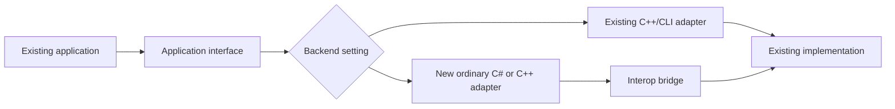

# Replace C++/CLI incrementally in an existing Visual Studio solution

This guide keeps **.NET Framework 4.8, C++17, and Windows x64** as the baseline.
Keep the existing `.sln`, application entry point, and working C++/CLI wrappers.
Introduce a new backend behind one small application interface, prove equivalent
behavior, and switch that boundary before migrating another.

The folder `managed_to_umanaged` is intentionally spelled as it exists in this
repository. Paths below are relative to `hostfxr-interop/`, unless stated otherwise.
`Product`, `NativeCore`, and `LegacyCli` are example names to replace with yours.

## 1. Inventory the boundaries before changing projects

Record each wrapper's caller, implementation, creation/destruction rules, data
types, exception behavior, thread affinity, and dependencies. Include callbacks
and return traffic: a C# → C++ operation may later call C# again.

| Existing boundary | Bridge for that call | First migration candidate |
| --- | --- | --- |
| C# calls a C++ class through a `ref class` | `managed_to_umanaged` | Synchronous method using primitive values |
| C++ calls a C# service through C++/CLI | `unmanaged_to_managed` | Public managed facade with explicit arguments |
| C# calls C++, which raises managed events | Requires an additional callback/event design | Keep the event seam in C++/CLI initially |
| Wrapper contains both business logic and conversion code | First extract the business logic into ordinary C++ or C# | Migrate the remaining narrow boundary |

Capture a baseline test and a deployment manifest while the old path still works.
Choose one bounded service with no UI affinity or callbacks for the pilot. Avoid
starting with the largest wrapper just because it contains the most `/clr` code.

**Exit check:** one boundary has an agreed contract, known owners, a repeatable
test, and a rollback path.

## 2. Add an interface and keep both backends

For C# callers, move the application-facing contract into a pure C# assembly.
Avoid exposing `LegacyCli` classes, `NativeObject`, or native pointers in it.
For C++ callers, use an ordinary C++ interface and application value types.



First implement the interface using the old wrapper only. Change callers to use
that interface and run the existing tests. This isolates the application rewrite
from the change in interop mechanism. Keep the selection at composition/startup;
an existing object's backend must remain fixed for its entire lifetime.

**Exit check:** the application still uses the old backend, but callers no longer
depend on C++/CLI types for this service.

## 3. Prepare the existing solution

Use Visual Studio 2022 with Desktop development with C++, a Windows SDK, .NET
Framework 4.8 targeting tools, and a compatible .NET SDK 8+ installation. The
bridge projects use C# 12 even when targeting `net48`; a recent compiler does not
change their runtime target. C# 12 requires VS/Build Tools 17.8 or .NET SDK 8 at
minimum; match the installed SDK to Visual Studio using Microsoft's
[compiler requirements](https://learn.microsoft.com/en-us/dotnet/csharp/language-reference/compiler-options/language)
and [SDK compatibility table](https://learn.microsoft.com/en-us/dotnet/core/porting/versioning-sdk-msbuild-vs).

Vendor this repository at a stable path, for example `external/hostfxr-interop/`.
There is currently no NuGet package, CMake install/export package, or checked-in
Visual Studio integration project. Create the small native projects below in
your existing solution, or consume separately built artifacts.

In Configuration Manager create/check `Debug|x64` and `Release|x64`. Map every
native project to x64. Set the application EXE to x64 and disable Prefer 32-bit
where available. A managed library may remain Any CPU if the host process is
x64; the bridge cannot load into a 32-bit host.

Create a property sheet for the new native projects:

| Property | Setting |
| --- | --- |
| C/C++ → Language → C++ Language Standard | ISO C++17 (`/std:c++17`) |
| Common Language Runtime Support | No Common Language Runtime Support |
| C/C++ → Code Generation → Enable C++ Exceptions | Yes (`/EHsc`) |
| C/C++ → Command Line → Additional Options | `/utf-8 /permissive-` |
| Runtime Library | `/MDd` for Debug, `/MD` for Release, matching linked libraries |
| Precompiled Headers for vendored bridge `.cpp` | Not Using Precompiled Headers |
| Intermediate Directory | Unique per project, platform, and configuration |

Check inherited property sheets and per-file settings as well: none of these new
translation units should compile with `/clr`. Keep `/clr` on legacy projects while
they still contain managed C++ types. See Microsoft's
[`/clr` documentation](https://learn.microsoft.com/en-us/cpp/build/reference/clr-common-language-runtime-compilation).
Objects and static libraries in one native link must use compatible runtime
library settings; see [`/MD` and `/MT`](https://learn.microsoft.com/en-us/cpp/build/reference/md-mt-ld-use-run-time-library).
Keep allocations and their matching frees inside their owning module.

## 4. Add the C# → C++ path

### Native projects

Create a **Static Library** project named `NativeInteropCore`:

- Add `managed_to_umanaged/src/interop.cpp` as an existing source file.
- Add `managed_to_umanaged/include` to Additional Include Directories.
- Set Target Name to `native_interop`, producing `native_interop.lib`.
- Apply the C++17 settings above. This direction needs no `INTEROP_NETFRAMEWORK`
  definition and does not link `mscoree.lib`.

Create a **Dynamic-Link Library** project named `ProductNativeAdapter`:

- Add the same include directory and reference `NativeInteropCore` with Link
  Library Dependencies enabled, or explicitly link the matching
  `native_interop.lib` through Additional Dependencies and Library Directories.
- Reference/link the existing ordinary C++ `NativeCore` library.
- Export `extern "C" NI_EXPORT int32_t NI_CALL ni_get_api(...)`.
- Link one copy of the bridge core into this plugin. Each plugin has its own
  registration and lease state; do not turn the bridge core into a shared global
  registry DLL.

Start by compiling the complete [sample plugin](../managed_to_umanaged/examples/native.cpp)
as the adapter's source and run the sample C# caller against
`ProductNativeAdapter.dll`. Then replace the sample registration with an adapter
around the real native class. The ABI cannot discover arbitrary C++ classes in an
existing DLL; each exposed type needs a factory and explicit member dispatch.

This minimal adapter assumes your existing `NativeCore.h` declares
`NativeCore::Counter(int32_t)` and `int32_t Add(int32_t)`:

```cpp
#include <native_interop/interop.hpp>
#include "NativeCore.h" // Application-specific existing class.
#include <mutex>

class CounterAdapter final : public native_interop::object {
    NativeCore::Counter counter_;
    std::mutex gate_;
public:
    explicit CounterAdapter(std::int32_t initial) : counter_(initial) {}
    native_interop::value call(std::string_view name,
        const native_interop::value::array& args) override {
        if (name == "Add") {
            if (args.size() != 1)
                throw std::invalid_argument("Add expects one Int32");
            auto delta = args[0].as<std::int32_t>();
            std::lock_guard<std::mutex> lock(gate_);
            return counter_.Add(delta);
        }
        return native_interop::object::call(name, args);
    }
};

extern "C" NI_EXPORT int32_t NI_CALL ni_get_api(
    uint32_t version, uint32_t size, ni_api* output) {
    try {
        static std::once_flag once;
        std::call_once(once, [] {
            native_interop::register_type("Product.Counter",
                [](const native_interop::value::array& args) {
                    if (args.size() != 1)
                        throw std::invalid_argument("Counter expects one Int32");
                    return std::make_shared<CounterAdapter>(
                        args[0].as<std::int32_t>());
                });
        });
        return native_interop::get_api(version, size, output);
    } catch (...) { return 1; }
}
```

The mutex is appropriate only if serialization matches the old contract.
Thread-affine classes need dispatch to their owning thread instead. Match native
overflow and exception behavior to the existing service rather than silently
changing it during migration.

### Managed project reference

Use **Add → Existing Project** to add
`managed_to_umanaged/managed/Interop.Native/Interop.Native.csproj` to the same
solution. Add a project reference from the new pure C# facade to `Interop.Native`.
Target that facade at .NET Framework 4.8 too. The bridge's default target is
`net48`; leave `InteropTargetFramework` at that value. Do not
define `NETFRAMEWORK` manually: the SDK supplies it for this target.

An SDK-style facade can use the following, adjusting the relative path:

```xml
<ItemGroup>
  <ProjectReference Include="..\external\hostfxr-interop\managed_to_umanaged\managed\Interop.Native\Interop.Native.csproj" />
</ItemGroup>
```

Try the Visual Studio project reference for an existing non-SDK `.csproj` too;
there is no requirement to convert that application project. If its older build
pipeline cannot build SDK-style references, build the bridge separately and add
a normal assembly reference. From the solution directory, for example:

```powershell
dotnet build .\external\hostfxr-interop\managed_to_umanaged\managed\Interop.Native\Interop.Native.csproj -c Release -p:InteropTargetFramework=net48 -o .\artifacts\interop\x64\Release
```

For a legacy project one directory below the solution root:

```xml
<ItemGroup>
  <Reference Include="Interop.Native">
    <HintPath>..\artifacts\interop\x64\$(Configuration)\Interop.Native.dll</HintPath>
    <Private>True</Private>
  </Reference>
</ItemGroup>
```

Run the matching Debug build for Debug consumers. Make this producer build a
pipeline dependency before the legacy application, not a manually remembered
step. Use either a project reference or this binary reference, not both.

### Preserve the application's typed interface

Before migration, a caller might construct `LegacyCli.Counter(10)` directly.
After extracting the contract, both implementations satisfy `ICounter`:

```csharp
using System;
using System.IO;
using Interop.Native;

public interface ICounter : IDisposable { int Add(int delta); }

// Application-specific wrapper names; adapt to the existing API.
public sealed class CliCounterBackend : ICounter
{
    private readonly LegacyCli.Counter counter;
    public CliCounterBackend(int initial) { counter = new LegacyCli.Counter(initial); }
    public int Add(int delta) { return counter.Add(delta); }
    public void Dispose() { counter.Dispose(); }
}

public sealed class BridgeCounterBackend : ICounter
{
    private readonly NativeRuntime runtime;
    private readonly NativeObject counter;
    public BridgeCounterBackend(int initial)
    {
        runtime = new NativeRuntime(Path.Combine(
            AppDomain.CurrentDomain.BaseDirectory, "ProductNativeAdapter.dll"));
        try { counter = runtime.LoadType("Product.Counter").Create(initial); }
        catch { runtime.Dispose(); throw; }
    }
    public int Add(int delta) { return counter.Call<int>("Add", delta); }
    public void Dispose()
    {
        try { counter.Dispose(); }
        finally { runtime.Dispose(); }
    }
}

public static class CounterFactory
{
    public static ICounter Create(bool useBridge, int initial)
    {
        if (useBridge) return new BridgeCounterBackend(initial);
        return new CliCounterBackend(initial);
    }
}
```

The example uses syntax suitable for older C# callers. Put each backend in its
own assembly when you want to eliminate the C++/CLI assembly reference from the
application later. Map `NativeException` to your established application exception
contract where necessary; exception type/message equivalence is not automatic.

A C# application already has a CLR. `NativeRuntime` loads the plugin through
`LoadLibraryW`, obtains `ni_get_api`, and calls the returned function pointers;
this direction does not create another CLR. Dispose each returned `NativeObject`,
including wrappers nested inside returned arrays. Use a shared service-level
runtime if objects must be passed to one another: handles from separate
`NativeRuntime` instances cannot be mixed.

**Exit check:** the same typed caller and tests run against either backend.

## 5. Add the C++ → C# path when a boundary needs it

Create another **Static Library** project, `ManagedInteropCore`:

- Compile `unmanaged_to_managed/src/hosting.cpp`, `bridge.cpp`, and `object.cpp`
  with `unmanaged_to_managed/include` on their include path. Keep the private
  `src/detail/bridge_state.hpp` beside those sources.
- Set Target Name to `interop`, producing `interop.lib`.
- Add `INTEROP_NETFRAMEWORK` to the core's preprocessor definitions. This C++
  macro selects Framework hosting and differs from C#'s SDK-defined `NETFRAMEWORK`.
- Link the final native consumer with `interop.lib` and `mscoree.lib`.
- Apply C++17, x64, matching runtime library, and no `/clr` as above.

Add `unmanaged_to_managed/managed/Interop.Managed/Interop.Managed.csproj` to the
existing solution and build it for `net48`. Build the target C# service assembly
for Framework 4.8 too. Arrange deployment/build dependencies for these assemblies;
the native `.vcxproj` does not need to reference them as C++/CLI metadata.

Put a plain C++ facade behind the application's existing native service interface.
For an application-defined C# `Product.Managed.Counter` with a public
`Counter(int)` constructor and `int Add(int)` method, its core operations are:

```cpp
#include <interop/interop.hpp>

void exercise_managed_counter(const std::filesystem::path& deploymentDirectory) {
    interop::runtime runtime(deploymentDirectory / L"Interop.Managed.dll");
    auto managedType = runtime.load_type(
        deploymentDirectory / L"Product.Managed.dll", "Product.Managed.Counter");
    auto managedObject = managedType.create({std::int32_t{10}});
    const auto sum = managedObject.call("Add", {std::int32_t{5}})
        .as<std::int32_t>();
    (void)sum;
} // C++ wrappers release their leases.
```

Pass an absolute deployment directory derived from the application location, not
the current working directory. Keep service objects alive for their intended
application lifetime; the function above illustrates a short scoped call only.
Constructed `IDisposable` objects are disposed after their final exported lease;
factory-returned objects are borrowed unless ownership is explicitly adopted.
Review [ownership and overload selection](../unmanaged_to_managed/README.md).

In a native EXE this bridge loads CLR v4 and bootstraps `Interop.Managed` in the
default AppDomain. The `v4.0.30319` runtime identifier is also used by Framework
4.8. The implementation retains its CLR host for process lifetime. It does not
stop/restart the runtime when a C++ wrapper leaves scope. See the
[host implementation](../unmanaged_to_managed/src/hosting.cpp) and Microsoft's
[CLR hosting interface](https://learn.microsoft.com/en-us/dotnet/framework/unmanaged-api/hosting/iclrruntimehost-interface).

If a native component is entered from an existing C# or C++/CLI host, identify the
already-loaded runtime and AppDomain first. This host path targets CLR v4's default
AppDomain; it does not preserve a caller's custom AppDomain or supply arbitrary
callback routing. Test coexistence in the real host before enabling that path.
Using both bridges does not automatically wire events or convert their unrelated
object handle types into each other.

**Exit check:** a plain C++ consumer invokes the managed facade without compiling
that consumer with `/clr`.

## 6. Make build and deployment repeatable

Prefer project references for native static-library and managed assembly
dependencies. Use explicit build/deployment dependencies for dynamically loaded
DLLs. A solution-only dependency does not apply when someone builds one project
directly; encode such steps in shared MSBuild targets or the CI build graph as
needed. See [project dependencies](https://learn.microsoft.com/en-us/visualstudio/ide/how-to-create-and-remove-project-dependencies)
and [MSBuild's solution/project distinction](https://learn.microsoft.com/en-us/visualstudio/msbuild/build-process-overview).

| Path | Required order |
| --- | --- |
| C# → C++ | `NativeCore` + `NativeInteropCore` → `ProductNativeAdapter`; `Interop.Native` → C# facade → app; stage plugin before running tests/app |
| C++ → C# | `ManagedInteropCore` → native consumer; `Interop.Managed` + target C# service → deployment; complete both branches before running |

Give each project its own intermediate/output directory. Stage final files into
`artifacts/app/x64/Debug` or `artifacts/app/x64/Release` after successful builds;
do not mix configurations or allow unrelated projects to overwrite outputs.
Build an existing `.sln` with Visual Studio MSBuild from its Developer PowerShell:

```powershell
msbuild .\Product.sln /restore /m /p:Configuration=Release /p:Platform=x64
```

For a concrete C# application copy step, set the native adapter's Output Directory
to `$(SolutionDir)artifacts\plugins\x64\$(Configuration)\`. Make the application
depend on `ProductNativeAdapter` in the solution so the plugin is built first.
For an application `.csproj` one directory below the solution root, add this
target after the normal build imports (adjust the path for other layouts):

```xml
<Target Name="CopyProductNativeAdapter" AfterTargets="Build">
  <PropertyGroup>
    <ProductPluginDir>$(MSBuildProjectDirectory)\..\artifacts\plugins\x64\$(Configuration)\</ProductPluginDir>
  </PropertyGroup>
  <ItemGroup>
    <ProductNativeRuntimeFile Include="$(ProductPluginDir)ProductNativeAdapter.dll" />
    <!-- Add explicit entries here for any required native dependency DLLs. -->
  </ItemGroup>
  <Error Condition="!Exists('%(ProductNativeRuntimeFile.Identity)')"
         Text="Missing native dependency: %(ProductNativeRuntimeFile.Identity). Build the native prerequisites first." />
  <Copy SourceFiles="@(ProductNativeRuntimeFile)"
        DestinationFolder="$(TargetDir)" SkipUnchangedFiles="true" />
</Target>
```

This target copies artifacts; it does not build the native project or prove that
an existing DLL is current. Building the `.csproj` alone requires the producer
build first in your pipeline, or a project-level MSBuild dependency. Keep x64
configuration mappings consistent with these explicit x64 paths. Use the same
pattern to copy `Interop.Managed.dll` and the managed service/dependency files
after their producer builds for a native host.

The runtime deployment set depends on the direction:

| C# → C++ | C++ → C# |
| --- | --- |
| Application EXE and configuration | Native application EXE and applicable configuration |
| Pure C# facade and `Interop.Native.dll` | `Interop.Managed.dll` and target service assemblies |
| `ProductNativeAdapter.dll`, native dependency DLLs | Native dependencies and service assembly dependencies |
| Framework 4.8 runtime; matching supported VC++ redistributable for `/MD` | Framework 4.8 runtime; matching supported VC++ redistributable for `/MD` |

Neither static `.lib` ships at runtime. No `hostfxr`, `nethost`, or
`.runtimeconfig.json` is required for this `net48` path. Keep legacy wrapper DLLs
in the deployment until rollback and unmigrated features no longer require them.
Preserve the application's existing assembly binding redirects and configuration;
a bridge DLL's own `.config` is not a replacement for host configuration.
If your solution requires strong-named assemblies, retain that policy and plan
signing for the new facade/bridge assemblies; the checked-in bridge projects do
not configure signing. Preserve assembly version/public-key identity where callers
depend on it. Do not remove signing globally to make a reference compile, and do
not assume a differently signed replacement DLL satisfies existing references.

Use a flat application directory for the first deployment. The current Framework
native loader passes an absolute plugin path to `LoadLibraryW`, but dependent DLLs
still follow Windows loader rules; loading a plugin from a subfolder alone does
not solve its dependency lookup. See
[DLL search order](https://learn.microsoft.com/en-us/windows/win32/dlls/dynamic-link-library-search-order).
Test on a clean Windows x64 machine without development `PATH` entries.

If you prefer CMake, build the bridges as an external dependency and feed outputs
into these same projects. The CMake link targets are `native_interop::native_interop`
and `interop::interop`; the build definitions are in each direction's
`CMakeLists.txt`. Do not add generated projects from a disposable CMake build tree
as your permanent solution integration. Current CMake managed build helpers use
Release even for a native Debug build; use explicit managed Debug builds for a
fully matching Debug integration.

**Exit check:** a clean checkout builds, stages, and runs both configurations
without copying a DLL by hand.

## 7. Prove parity and roll out one boundary

Run the same contract suite against `CliCounterBackend` and
`BridgeCounterBackend`. Compare results and observable behavior, not internal
pointer/handle identity. Cover construction, missing members, numeric widths and
overflow, nulls, Unicode/embedded NUL strings, arrays, errors, disposal, repeated
creation, and threading behavior appropriate to the service.

Measure representative hot paths; reflective dispatch and value copying may
require batching. Do not infer performance from the one-call sample. Track
`NativeRuntime.LiveHandles` or `interop::runtime::live_handles()` returning to a
baseline after disposal. Native live handles count exported leases, not every
application-owned native object; the managed direction can also retain type
handles while wrappers remain alive.

Keep the old backend as the default initially. Enable the new one for the pilot
boundary, then widen usage after parity, leak, deployment, and performance checks
pass. Record backend selection and failures in the application's normal logging.
For side-effecting operations, do not execute both backends against production
state just to compare them; use isolated fixtures or recorded inputs.

Rollback means selecting the old backend for newly created services, normally
after a process restart, with the previous artifacts available. Do not retry a
failed state-changing call automatically through the old backend: the first call
may already have committed work. Dispose/drain objects on their original backend
before switching; handles and state do not transfer between implementations.

**Exit check:** the selected boundary can be enabled and rolled back independently
without replacing the rest of the application's interop layer.

## 8. Leave unsupported seams until their design is explicit

These bridges are not a drop-in replacement for every C++/CLI feature:

| Existing wrapper feature | Migration decision |
| --- | --- |
| Delegates, events, virtual overrides into managed code | Design registration, callback lifetime, threading, and unregistration; retain the old seam until then |
| `ref`/`out`, raw pointers, pinned buffers, `Span<T>`, custom structs | Define explicit value/array DTOs or a new ABI extension; no automatic pointer or by-reference translation |
| UI/COM apartment affinity or synchronous cross-thread callbacks | Keep dispatch/COM initialization in the application; the bridge supplies neither a UI dispatcher nor apartment policy |
| Custom AppDomains, unload/reload, remoting | Design separately; Framework hosting currently uses the default AppDomain |
| Public C++/CLI types in third-party contracts | Preserve a compatibility wrapper until consumers can migrate; names alone do not preserve assembly identity or binary compatibility |
| Shared raw native identity or global mutable state | Establish ownership and synchronization; bridge handles are opaque leases, not native addresses |

Do not put business logic into string-based dispatch. Keep a narrow typed facade,
validate inputs in adapters, and add a contract test whenever the boundary grows.

## 9. Remove C++/CLI only after its last consumer is gone

Repeat the pilot sequence service by service. Search for remaining `#using`,
`gcnew`, `ref class`, `gcroot`, managed handles, and assembly references, including
tests, plugins, installers, and build scripts. These are review aids, not proof
that every dependency has disappeared.

Once a legacy wrapper has no consumers and the rollback window is closed, remove
its references and deployment entries. If a project is now entirely native,
remove `/clr`, managed metadata imports, and obsolete CLR-specific settings from
all configurations and inherited property sheets. Otherwise split out the pure
native portion and keep the residual managed wrapper until its own migration is
complete. Rebuild from clean outputs and repeat installation and contract tests.

**Completion check:** the migrated feature has a typed interface, one supported
backend, deterministic ownership, a reproducible Windows build/deployment, and
no remaining dependency on its former C++/CLI wrapper.
