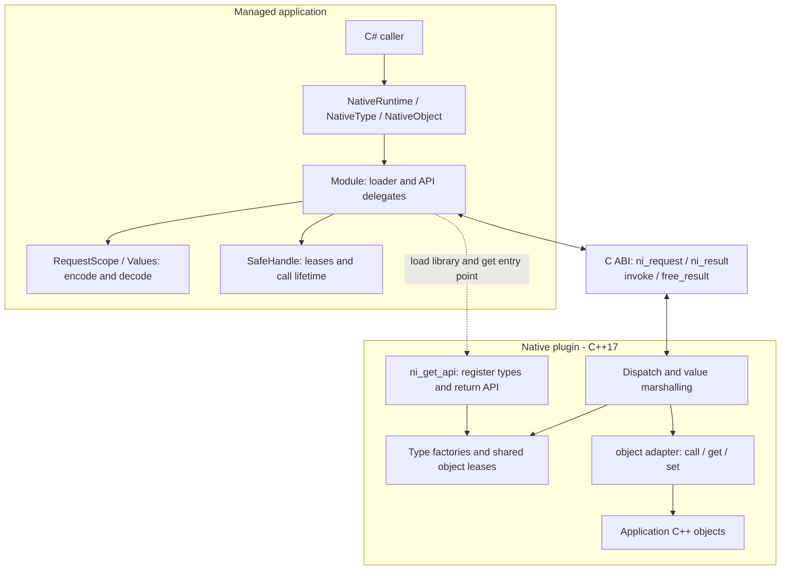
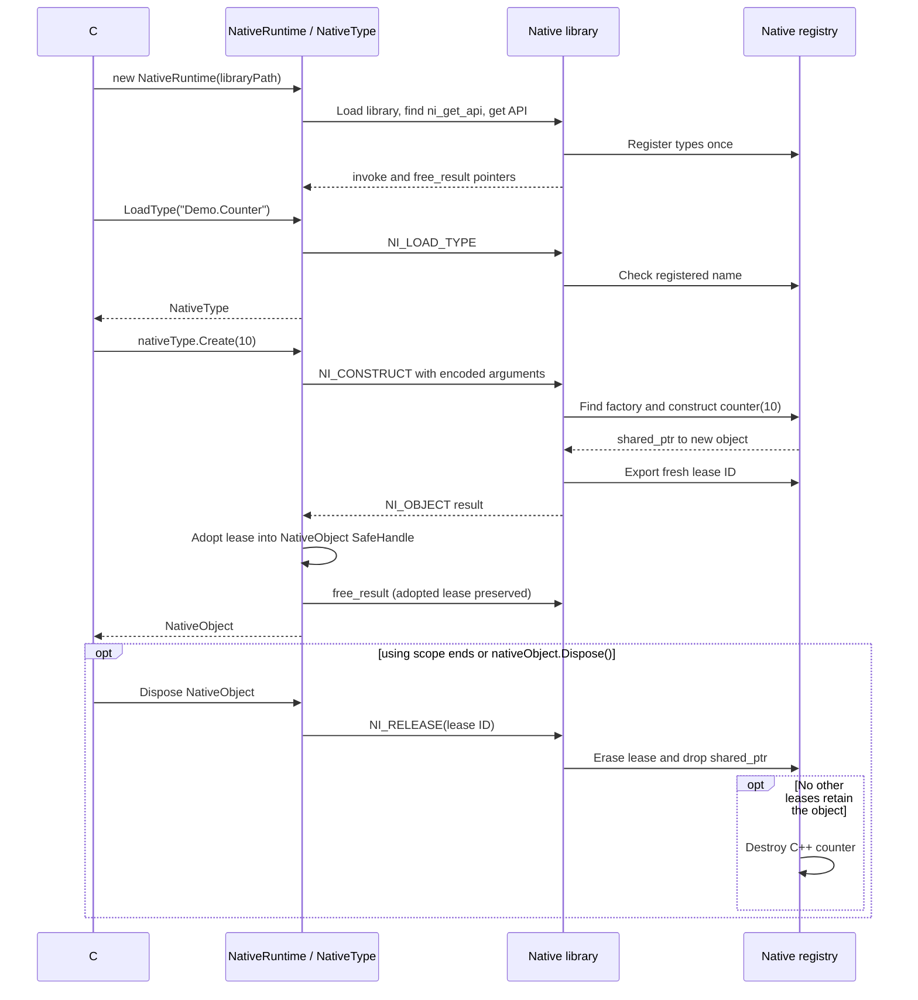
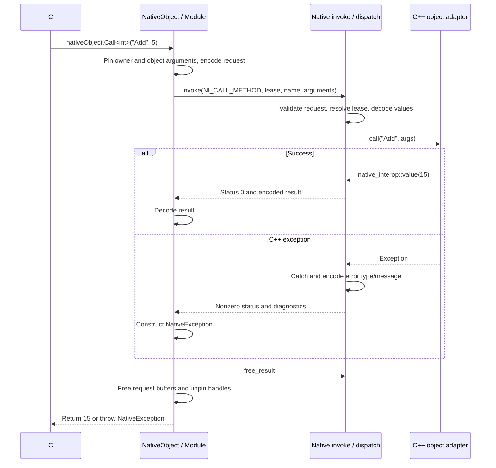

# Managed → unmanaged interop

A **.NET Framework 4.8** application can create and use registered **C++17**
objects in a native DLL. The managed API exposes `NativeRuntime`, `NativeType`,
and `NativeObject`. Optional modern .NET 8+ builds also load native libraries on
Linux and macOS. The primary deployment target is Windows x64; both the managed
process and native library must be 64-bit with matching architectures.

## Architecture

The managed application loads a native library and calls its exported `ni_get_api`
function to obtain `invoke` and `free_result` callbacks. Both sides execute in the
same process. The managed application already runs inside a CLR, so this direction
does not start or host another runtime.



The native [ABI contract](include/native_interop/abi.h) uses fixed-layout structs
and C calling conventions. The [registration interface](include/native_interop/interop.hpp)
wraps C++ classes in adapters with explicitly exposed members. The
[managed API](managed/Interop.Native/NativeRuntime.cs) offers constructor calls,
instance and static methods, and property access. C++ exceptions become
`NativeException` instances with a `NativeType` and message.

## Build and run

Run these commands from `managed_to_umanaged/`. Use Visual Studio 2022 C++ desktop
tools, CMake 3.22+, and .NET SDK 8+ for compilation. The default managed target is
`net48`; NuGet supplies the Framework reference assemblies. Deploy with the
.NET Framework 4.8 runtime.

```powershell
cmake -S . -B build -A x64
cmake --build build --config Release
ctest --test-dir build -C Release --output-on-failure
.\build\managed\native_managed_example\Interop.Native.Example.exe .\build\Release\native_sample.dll
```

For an installed modern .NET target on Linux:

```sh
cmake -S . -B build-modern -DINTEROP_TARGET_FRAMEWORK=net8.0 -DCMAKE_BUILD_TYPE=Release
cmake --build build-modern --parallel
ctest --test-dir build-modern --output-on-failure
dotnet build-modern/managed/native_managed_example/Interop.Native.Example.dll \
  "$PWD/build-modern/libnative_sample.so"
```

On macOS use `libnative_sample.dylib`. A root build places these outputs under
`build-all/managed_to_umanaged/` instead of the standalone `build/` directory.
Use a fresh build directory when switching runtime targets.

Reference `managed/Interop.Native/Interop.Native.csproj` from your C# project,
using the same `InteropTargetFramework` property when selecting modern .NET.
For a native plugin, link the CMake target `native_interop::native_interop` into a
shared library and export the C function `ni_get_api`. The two projects in
[examples](examples) demonstrate both sides.

## Creating and calling a native object

```csharp
using Interop.Native;

using var runtime = new NativeRuntime("native_sample.dll");
var nativeType = runtime.LoadType("Demo.Counter");
using var nativeObject = nativeType.Create(10);

int sum = nativeObject.Call<int>("Add", 5); // 15
nativeObject.Set("Value", 42);
int current = nativeObject.Get<int>("Value"); // 42

string echoed = nativeType.Call<string>("Echo", "Hello from C#");
using var alias = nativeObject.Call<NativeObject>("Self");
```

`Create(10)` sends an `Int32` argument to the registered factory, which constructs
the C++ `counter`. `nativeObject` owns one lease for that instance. `Self` returns
a separate lease sharing the same `std::shared_ptr`; disposing one wrapper leaves
the other usable. Assigning `var sameWrapper = nativeObject` creates another C#
reference to the same wrapper, so those references share its disposal state.

The non-generic `Call` and `Get` methods return `object?`. Their generic versions
perform a checked cast. A failed cast releases any native object leases in the
rejected result, including nested arrays. `LoadType` checks the registered name
immediately; a missing constructor, method, or property produces a native error.

### Registering C++ types

Implement `native_interop::object` to adapt the methods and properties you want to
expose. The complete [sample plugin](examples/native.cpp) implements `counter` and
its static members, then registers them in its entry point:

```cpp
extern "C" NI_EXPORT int32_t NI_CALL ni_get_api(
    uint32_t version, uint32_t size, ni_api* output) {
    try {
        static std::once_flag once;
        std::call_once(once, [] {
            native_interop::register_type("Demo.Counter",
                [](const native_interop::value::array& args) {
                    if (args.size() > 1)
                        throw std::invalid_argument("Expected zero or one Int32 argument");
                    return std::make_shared<counter>(
                        args.empty() ? 0 : args[0].as<std::int32_t>());
                }, std::make_shared<static_members>());
        });
        return native_interop::get_api(version, size, output);
    } catch (...) { return 1; }
}
```

The factory returns a `std::shared_ptr<object>`. The optional third argument
handles static `call`, `get`, and `set` requests. Adapters validate argument counts
and types before accessing them. C++17 has no automatic reflection: overload
selection, conversions, and member names are defined by the adapter. This API
does not discover arbitrary symbols or class layouts in an existing DLL.

## Object creation flow

`nativeType.Create(10)` creates a `counter` through its registered factory. The
native registry owns the resulting object lease; `NativeObject` owns the lease ID
through a `SafeHandle`.



On Framework, the loader uses `LoadLibraryW` and `GetProcAddress`. With modern
.NET selected, it uses `NativeLibrary.Load` and `GetExport`. The managed side
validates the API version and layout before converting the returned function
pointers into delegates with an explicit C calling convention. See the
[delegate marshalling API](https://learn.microsoft.com/en-us/dotnet/api/system.runtime.interopservices.marshal.getdelegateforfunctionpointer).

## Function call flow



`Module.Perform` keeps the owner and any object arguments alive during a call.
`RequestScope.Encode` allocates request buffers; native `read` decodes them.
Native `dispatch` resolves the target and invokes the adapter. Native `write`
creates owned result buffers and exports object leases; managed `Values.Decode`
copies values and adopts leases. The `finally` block always frees the native result.
No C++ exception crosses the C ABI.

| C# operation | ABI operation | Native handler |
| --- | --- | --- |
| `runtime.LoadType(name)` | `NI_LOAD_TYPE` | Registered type lookup |
| `nativeType.Create(args)` | `NI_CONSTRUCT` | Registered factory |
| `nativeType.Call/Get/Set` | `NI_CALL_STATIC`, `NI_GET_STATIC`, `NI_SET_STATIC` | Static adapter |
| `nativeObject.Call/Get/Set` | `NI_CALL_METHOD`, `NI_GET`, `NI_SET` | Instance adapter |
| `nativeObject.Dispose()` or finalization | `NI_RELEASE` | Erase lease, release shared ownership |
| `runtime.LiveHandles` | `NI_LIVE_HANDLES` | Count exported object leases |

## Values and lifetime

Supported values are null, bool, signed and unsigned 8/16/32/64-bit integers,
32/64-bit floating point, UTF-16 `char`, UTF-8 strings, `NativeObject`, and arrays.
Strings preserve embedded NUL characters. Numeric widths remain explicit: C#
`int` maps to `std::int32_t`, while `long` maps to `std::int64_t`. One-dimensional
arrays with zero-based indices, including nested arrays, are accepted. Returned
arrays are `object?[]` containing boxed values and object wrappers. Nesting is
limited to 32 levels. To pass an array as one `params` argument, use:

```csharp
object?[] values = nativeType.Call<object?[]>("Echo", (object)new int[] { 1, 2, 3 });
```

Dispose every returned `NativeObject`, including objects inside returned arrays.
Each exported lease holds a native `shared_ptr`. Its final release destroys the
object when no other native owner remains. `SafeHandle` supplies fallback cleanup
for abandoned wrappers; `using` gives deterministic release. Native destructors
must not throw. The runtime and each object retain the library; disposing the
runtime prevents further operations through its `NativeType` wrappers while
existing `NativeObject` instances stay usable. The loader reference is released
after the last owner and active call are released; the OS may retain the library
if other references remain. Handles cannot be passed across separate
`NativeRuntime` instances, even if they load the same library.

The registry synchronizes lease access, and calls hold temporary shared ownership
of their targets. Adapters must synchronize mutable object state; the sample uses
a mutex. Managed calls pin their handles so concurrent disposal cannot destroy a
target during its invocation. See [SafeHandle.DangerousAddRef](https://learn.microsoft.com/en-us/dotnet/api/system.runtime.interopservices.safehandle.dangerousaddref).

Native plugins are independent: link the core statically into each plugin and
keep internal symbols hidden, as in the sample CMake target. Only `ni_get_api`
needs to be exported. The ABI exports values and opaque leases rather than STL
types, so allocation and deallocation remain on the same side of the boundary.
