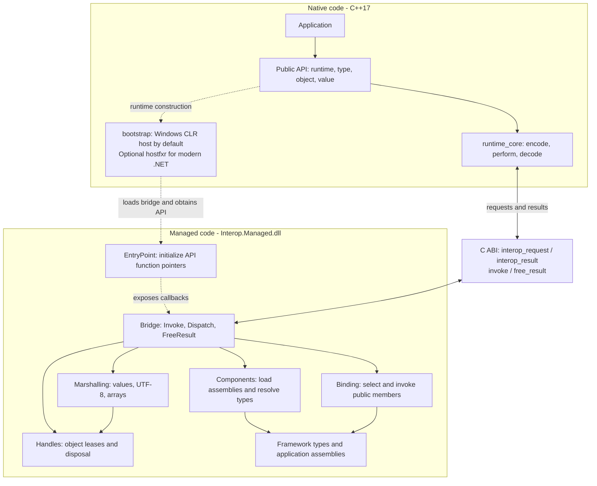
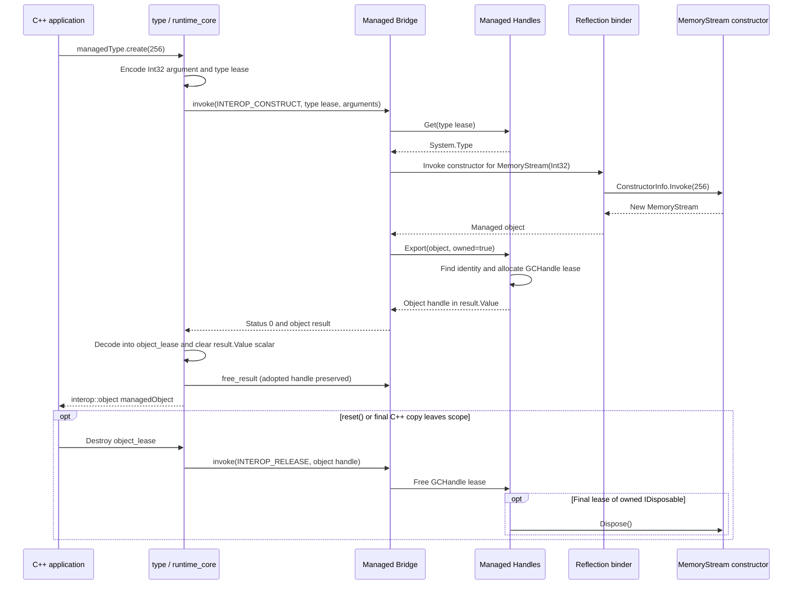
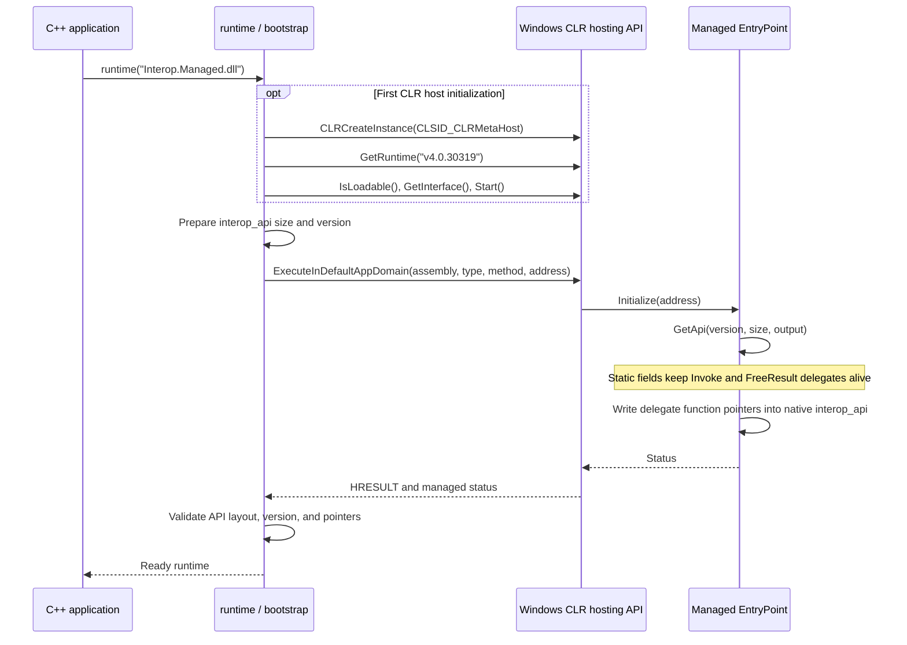
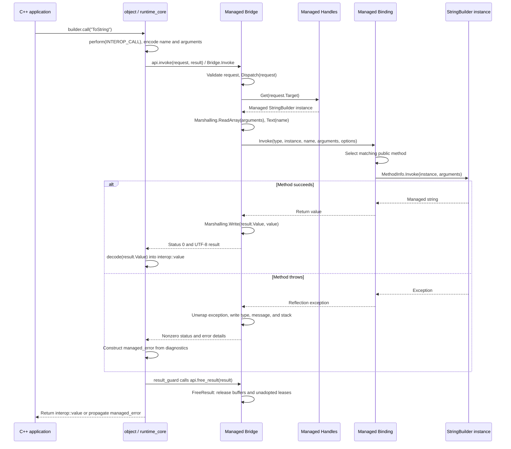

# C++ / .NET interop

The primary target is **C++17 and .NET Framework 4.8 on Windows x64**.
Native C++ applications can construct managed objects, call methods, access
properties, and receive managed exceptions through a stable C ABI. Exported object
leases keep managed objects alive; constructed `IDisposable` objects are disposed
when their final lease is released.

## Architecture

The C++ application and managed code run in the same process. The C++ library
hosts the CLR and exchanges requests and results with `Interop.Managed.dll`
through a C ABI: fixed-layout structs and two function pointers, `invoke` and
`free_result`.



Hosting establishes the function pointers during `runtime` construction.
Subsequent calls use those pointers directly. `Components` finds managed types,
`Binding` uses reflection to select and invoke their members, and `Handles` keeps
exported objects alive while C++ holds leases.

The C++ implementation has one public header and one source file. Start at
`interop::object` in the header, then follow `object_lease` and `runtime_core` in
the source. The C ABI is declared separately because the managed bridge also uses
its layouts.

| File | Start here for |
| --- | --- |
| [interop.hpp](include/interop/interop.hpp) | Public C++ `runtime`, `type`, and `object` wrappers |
| [interop.cpp](src/interop.cpp) | CLR startup, ABI transport, wrapper methods, and lease release |
| [abi.h](include/interop/abi.h) | C ABI layout and ownership rules |
| [Bridge.cs](managed/Interop.Managed/Bridge.cs) | Managed request dispatch |
| [Handles.cs](managed/Interop.Managed/Handles.cs) | GCHandle leases and disposal policy |

## Build for .NET Framework 4.8

Run these commands from `unmanaged_to_managed/`.

Use Visual Studio 2022 with the C++ desktop tools and Windows SDK, CMake 3.22+,
and a .NET SDK 8+ to compile the C# bridge. The resulting bridge targets `net48`;
applications require the .NET Framework 4.8 runtime, not a modern .NET runtime.
The build restores the Framework reference assemblies from NuGet.

```powershell
cmake -S . -B build -A x64
cmake --build build --config Release
ctest --test-dir build -C Release --output-on-failure
.\build\Release\interop_example.exe .\build\managed\interop_bridge\Interop.Managed.dll
```

`INTEROP_TARGET_FRAMEWORK` defaults to `net48`. The native library hosts CLR v4
using [`ICLRRuntimeHost`](https://learn.microsoft.com/en-us/dotnet/framework/unmanaged-api/hosting/iclrruntimehost-executeindefaultappdomain-method); no hostfxr pack or runtimeconfig file is needed for this
target. Managed callbacks use delegates rooted for the lifetime of the AppDomain.
Component assemblies load into the default AppDomain with `Assembly.LoadFrom`;
dependencies should be deployed alongside them. Framework assembly identity and
binding rules apply, so this mode does not isolate conflicting dependency versions.
The runtime remains loaded for the process lifetime.

## Optional modern .NET host

Modern .NET 8+ remains available on supported 64-bit platforms. Select the target
explicitly, using an installed targeting pack and matching runtime:

```sh
cmake -S . -B build-modern -DINTEROP_TARGET_FRAMEWORK=net8.0 -DCMAKE_BUILD_TYPE=Release
cmake --build build-modern --parallel
ctest --test-dir build-modern --output-on-failure
```

This mode uses hostfxr and the `.runtimeconfig.json` beside the bridge assembly.
Use a separate build directory when changing runtime targets. Linux and macOS
require this explicit option; the default Framework host requires Windows.

## C++17 usage

Link the CMake target `interop::interop` and include `<interop/interop.hpp>`.
Arguments accept initializer lists or `std::vector<interop::value>`.
Existing callers using the former C++20 `std::span` overloads should pass vectors.

```cpp
interop::runtime runtime("Interop.Managed.dll");
auto type = runtime.resolve_type("System.Text.StringBuilder");
auto builder = type.create({"Hello"});
builder.call("Append", {" from C++17"});
auto text = builder.call("ToString").as<std::string>();
```

Use unqualified core type names, such as `System.String`, across both runtimes.
Explicit core assembly names differ: `mscorlib` on Framework and
`System.Private.CoreLib` on modern .NET. The bridge and component assemblies must
target the selected runtime. ABI v1 requires 64-bit processes; x86 is unsupported.

### Creating a managed object

Use `type.create(...)` to invoke a public constructor. For example, this creates
a managed `MemoryStream` with an initial capacity of 256 bytes, equivalent to
`new System.IO.MemoryStream(256)` in C#:

```cpp
interop::runtime runtime("Interop.Managed.dll");
auto managedType = runtime.resolve_type("System.IO.MemoryStream");
auto managedObject = managedType.create({std::int32_t{256}});

managedObject.call("WriteByte", {std::uint8_t{42}});
auto length = managedObject.get("Length").as<std::int64_t>(); // 1 byte

// Releasing the final lease calls MemoryStream.Dispose().
managedObject.reset();
```

`managedObject` is an `interop::object` that holds a lease keeping the managed
instance alive. The explicit `std::int32_t` argument selects the constructor that
takes a `System.Int32`; `managedType.create()` selects a parameterless constructor.
For a type in your own assembly, obtain `managedType` with
`runtime.load_type("MyLibrary.dll", "MyLibrary.MyClass")`, then call `create` with
that class's constructor arguments.

Creation follows `type::create` → `runtime_core::perform(INTEROP_CONSTRUCT)` →
`Bridge.Invoke` / `Dispatch` → `Binding.Invoke` → `ConstructorInfo.Invoke`.
`Marshalling.Write` exports the new instance through `Handles.Export` as an owned
lease, and C++ `decode` adopts it into the returned `interop::object`. If the
constructor throws, the caller receives a `managed_error`. Leaving the C++ scope
also releases the lease, so an explicit `reset()` is optional.

#### Object creation flow

The type lease obtained by `resolve_type` identifies `System.IO.MemoryStream`.
The returned object gets a separate GCHandle lease, which the C++ wrapper owns.



## Runtime startup flow

For the default `net48` build, constructing `interop::runtime` performs this
handshake. The CLR host is initialized once per process and retained; each runtime
wrapper obtains and validates the bridge API.



The `address` is the native API struct's address encoded as a string, matching the
`Initialize(string)` entry point required by this hosting API. `GetApi` fills the
struct with callbacks for `Bridge.Invoke` and `Bridge.FreeResult`.

With modern .NET selected, `bootstrap` instead locates hostfxr, initializes it from
the bridge's runtimeconfig file, and obtains `load_assembly_and_get_function_pointer`.
It uses that loader to obtain `EntryPoint.GetApi`, then calls it to fill the same
API struct. The C# `#if NETFRAMEWORK` branches select the delegate implementation
for `net48`; modern .NET uses `UnmanagedCallersOnly` entry points. This selection
happens at build time.

## Function call flow

In the C++ example above, `builder.call("ToString")` follows this path. The call
runs synchronously; the C++ caller receives its result after managed execution and
result cleanup finish.



1. `object::call` passes the object's GCHandle lease value, member name, and arguments to
   `runtime_core::perform`. `encode` represents values using the tags and layouts
   in `abi.h`; request strings are UTF-8 and request buffers remain valid for the call.
2. `Bridge.Invoke` validates the request. `Dispatch` resolves the lease through
   `Handles.Get`, decodes the arguments, and chooses the operation handler.
3. `Binding.Invoke` selects a public overload by argument types and specificity.
   `call_options.parameter_types` supplies an exact signature when needed, and
   `generic_types` supplies generic method type arguments. Numeric widths must match.
4. `Marshalling.Write` encodes the managed return value. Strings become UTF-8
   buffers, supported arrays become arrays of ABI values, and other objects become
   GCHandle lease values. `decode` copies values into C++ storage and adopts returned object
   leases into `interop::object` wrappers.
5. The C++ result guard always calls `free_result`, including during exception
   unwinding. Managed exceptions become status codes and diagnostic fields at the
   ABI boundary; C++ reconstructs them as `managed_error`. If diagnostics could not
   be produced, C++ throws `std::runtime_error` with the status instead.

The other public calls share the same request path, with different operation codes:

| C++ call | ABI operation | Managed handler |
| --- | --- | --- |
| `runtime.resolve_type(name)` / `load_type(path, name)` | `INTEROP_LOAD_TYPE` | `Components.LoadType` / `Resolve`; returns a lease for a `System.Type` |
| `type.create(args)` | `INTEROP_CONSTRUCT` | `Binding.Invoke` → `ConstructorInfo.Invoke`; returns an owned object lease |
| `type.call(name, args)` | `INTEROP_CALL_STATIC` | `Binding.Invoke` → static `MethodInfo.Invoke` |
| `object.call(name, args)` | `INTEROP_CALL` | `Binding.Invoke` → instance `MethodInfo.Invoke` |
| `type.get/set` / `object.get/set` | `INTEROP_GET_STATIC/SET_STATIC` / `INTEROP_GET/SET` | `Binding.Member` → public property or field access |
| `object.dispose()` | `INTEROP_DISPOSE` | `Handles.Dispose` |
| `object.take_ownership()` | `INTEROP_TAKE_OWNERSHIP` | `Handles.TakeOwnership` |
| Final C++ copy of a lease is released | `INTEROP_RELEASE` | `Handles.Release` |

For example, `resolve_type("System.Text.StringBuilder")` first obtains a type
lease. `type.create({"Hello"})` uses that lease to select the constructor and returns
a new instance lease. `builder.call("Append", {" from C++17"})` then uses the instance
lease to invoke `Append`. Its returned `StringBuilder` is another lease for the
same managed object; the temporary C++ result releases that lease at the end of
the statement. `ToString` returns a copied string instead.

### Object lifetime and cleanup

Copying an `interop::object` shares its existing C++ lease. Its declared destructor
is implemented in `interop.cpp`; the final copy destroys `object_lease`, which calls
`runtime_core::release` and sends `INTEROP_RELEASE` to `Handles.Release`. Each
exported lease is a normal GCHandle to a managed identity record; it keeps the
object alive without pinning
its address. A `ConditionalWeakTable` joins separate leases for the same object,
so releasing the final lease of an owned object calls `IDisposable.Dispose` once.

The C++ RAII wrapper must be the only owner of each handle value. GCHandle slots
can be reused after `Free`, so the ABI cannot safely validate a stale or invented
value. Do not retain raw handles beyond the wrapper lifetime or call `RELEASE`
twice. The registry-based baseline branch provides checked, never-reused IDs if
untrusted or manually managed ABI callers need stale-handle rejection.

Objects created through `type.create` are owned. Objects returned by methods or
properties are borrowed unless that identity is already owned; `take_ownership()`
opts a borrowed object into automatic disposal. Explicit `dispose()` affects all
aliases and reports managed errors. Automatic cleanup suppresses disposal errors
so C++ destructors remain nonthrowing. Releasing wrappers leaves the CLR running
for the lifetime of the process.
